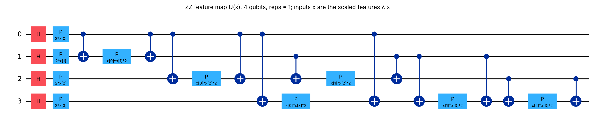
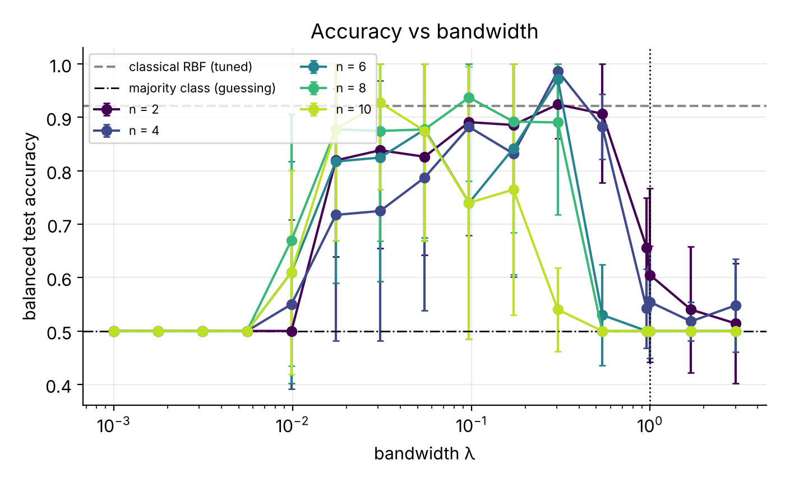
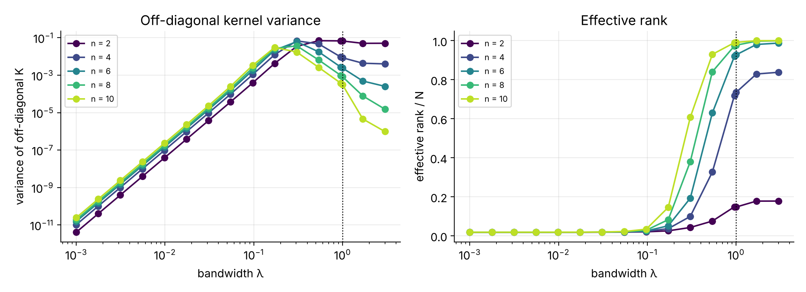
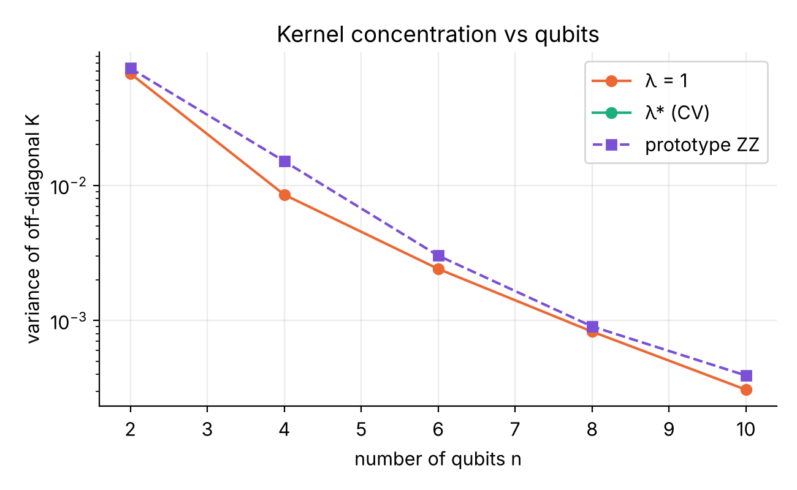
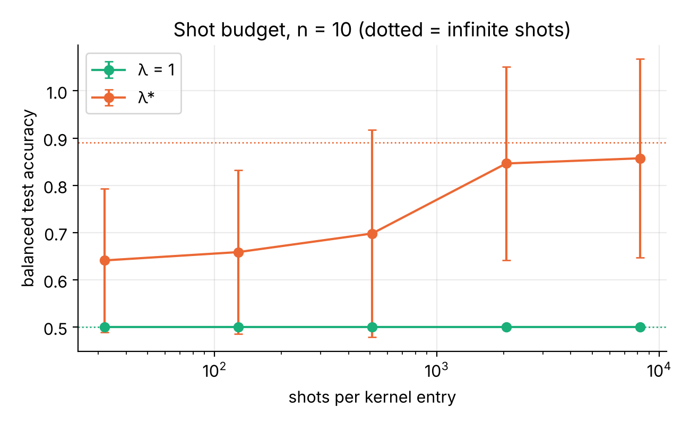
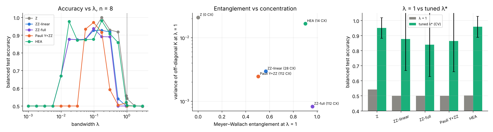
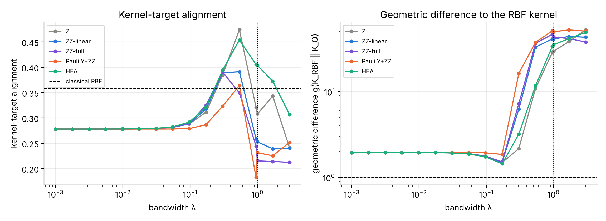
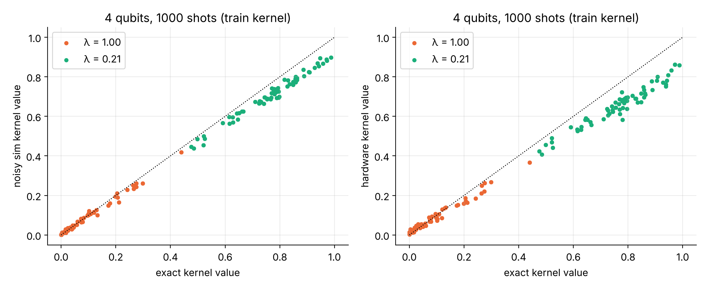
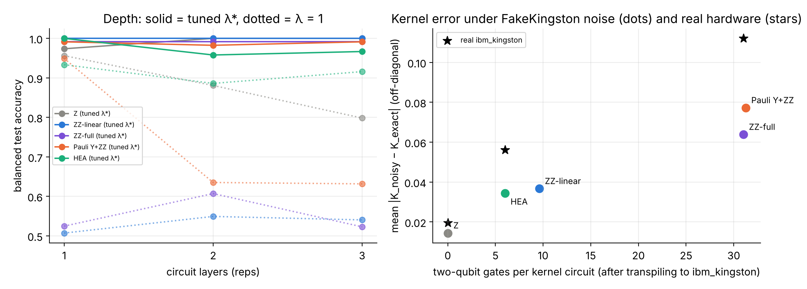
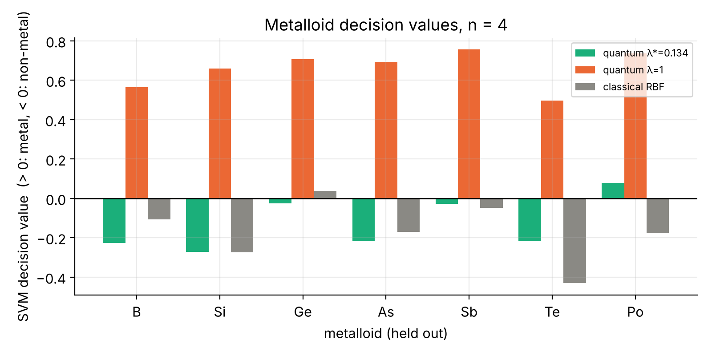

# Metal / non-metal classification with quantum kernels

**Interstate Quantum Hackathon 2026, QML track**

| | |
|---|---|
| Group name | Bandwidth Matters |
| Member | Lakshikka Sithamparanathan (solo) |
| Affiliation | Cleveland State University |
| Department | Department of Computer Science |
| Career level | PhD student |
| Category | Champion |

## Summary

- Built a quantum-kernel SVM (QSVM) that classifies the elements Z = 1–86 as metal or non-metal from ten physical properties. Scores are balanced accuracy (0.50 = guessing), because 77 % of the elements are metals.
- Showed that the default ZZ kernel (bandwidth λ = 1) and the prototype both fail from 6 qubits upward: they label every element a metal because the kernel concentrates.
- Tuned the bandwidth λ by cross-validation. The quantum kernel then reaches 0.83–0.97, on par with a tuned classical SVM.
- Showed that λ should be selected with shot noise included: this gives higher accuracy at 1000 shots than selecting λ on the simulator.
- Compared five feature maps; after tuning, the shallow ones (Z, hardware-efficient) are the most accurate and stable.
- Checked for room for a quantum advantage with the geometric difference test: there is none on this data.
- Ran the kernels on IBM hardware (ibm_kingston): the tuned kernel keeps 0.875 accuracy, the untuned one stays at 0.50, and the kernel error grows with the number of two-qubit gates.
- Used the trained model on the held-out metalloids; its answers agree with chemistry.

## Motivation

I chose the QML track because kernel bandwidth is my research area (*Spectral Learning Rates for Bandwidth-Tuned Quantum Kernels*, IEEE Quantum Week 2026). The training notebook (Part 5) shows that quantum kernels concentrate on random data and that a bandwidth λ helps. The metal / non-metal task is a small, real materials problem, which makes it a good test of whether this matters in practice: on real data, with finite shots, and on real hardware.

## Workflow

1. **Data:** 86 elements from the `mendeleev` database, 10 features (electronegativity, ionization energy, electron affinity, three radii, density, atomic weight, period, group). 61 metals and 18 non-metals; the 7 metalloids are held out.
2. **Preprocessing** (training split only): imputation, standardisation, PCA to *n* features for *n* qubits, scaling to [0, π]. 10 random 70/30 splits.
3. **Quantum kernel:** ZZ feature map with angles λ·xᵢ and λ²·xᵢxⱼ; kernel K = |⟨ψ(x′)|ψ(x)⟩|², computed exactly with statevectors for the sweeps.
   

   *Fig. 0. ZZ feature map U(x) for 4 qubits (reps = 1, as used on hardware). Each kernel entry is measured with the compute–uncompute circuit U(x′)†U(x) as the probability of 0000. Because the inputs are λ·x, the one-qubit phases scale with λ and the two-qubit phases with λ².*

4. **Model:** SVM on the precomputed kernel; C and λ chosen by 5-fold cross-validation on the training data only.
5. **Studies:** λ sweep for 2–10 qubits; λ selection with exact vs 1000-shot kernels; five feature maps; geometric difference to the classical RBF kernel; 4-qubit hardware runs (162 circuits × 1000 shots per job, dynamical decoupling and measurement twirling) on ibm_kingston and its noise model; metalloid predictions.

Code: [`qkernel_bandwidth.ipynb`](qkernel_bandwidth.ipynb) (first cell installs all packages; hardware results are cached, so it runs without IBM credentials).

## Results

### 1. Bandwidth decides whether the QSVM works

*Fig. 1. Balanced test accuracy against bandwidth λ (mean ± std, 10 splits). Too small or too large λ gives 0.50 (guessing). Around λ ≈ 0.02–0.3 the quantum kernel matches the tuned classical SVM (dashed line).*

| qubits | prototype ZZ | λ = 1 | tuned λ (simulator) | λ tuned on simulator, run at 1000 shots | λ tuned at 1000 shots | classical SVM |
|---|---|---|---|---|---|---|
| 2 | 0.60 | 0.61 | 0.90 | 0.80 | 0.89 | 0.89 |
| 4 | 0.52 | 0.55 | 0.89 | 0.80 | 0.87 | 0.97 |
| 6 | 0.50 | 0.50 | 0.97 | 0.84 | 0.92 | 0.98 |
| 8 | 0.50 | 0.50 | 0.84 | 0.79 | 0.89 | 0.90 |
| 10 | 0.50 | 0.50 | 0.83 | 0.63 | 0.73 | 0.87 |

*Balanced test accuracy, mean over 10 splits (std 0.04–0.24).*

*Fig. 2. Left: variance of the off-diagonal kernel entries against λ; it collapses at small λ and falls with qubit count at large λ. Right: effective rank of the kernel matrix (divided by N); close to 0 for small λ (kernel nearly constant) and close to 1 for large λ (kernel nearly the identity).*

*Fig. 3. Kernel variance against the number of qubits. At λ = 1 and for the prototype it falls exponentially (concentration); at the tuned λ* it does not.*

*Fig. 5. 10 qubits: balanced accuracy against shots per kernel entry. At λ = 1 more shots do not help; at the tuned λ accuracy rises from 0.64 (32 shots) to 0.86 (8192 shots), against 0.89 for exact kernels.*

- From 6 qubits up, the prototype and λ = 1 label every element a metal (0.50).
- Choosing λ with 1000-shot kernels beats choosing it on the simulator and then running with shots, at every qubit count (by up to 10 points).

### 2. Feature maps and quantum advantage

*Fig. 7. Eight qubits. Left: accuracy vs λ per feature map. Middle: more entanglement gives more concentration at λ = 1. Right: accuracy at λ = 1 and after tuning.*

- At λ = 1 every entangling map scores 0.50 at 8 qubits.
- After tuning, the shallow maps are best: Z 0.95 and hardware-efficient 0.96, against ZZ-full 0.84 (112 CX gates).

*Fig. 10. Four qubits. Left: kernel-target alignment against λ. Right: geometric difference g between each quantum kernel and the classical RBF kernel.*

- At the tuned λ, g ≈ 1.5–3, meaning a classical kernel can represent the quantum kernel. g only becomes large (30–50) where the quantum kernels have concentrated and fail. So there is no quantum advantage on this task, which is consistent with the classical SVM matching the QSVM.

### 3. IBM hardware (ibm_kingston)

*Fig. 6. Measured against exact kernel values, 4 qubits, 1000 shots. Left: noise model. Right: ibm_kingston.*

| λ | exact | noise model | ibm_kingston |
|---|---|---|---|
| 1 (untuned) | 0.50 | 0.50 | 0.50 |
| 0.21 (tuned) | 1.00 | 0.875 | 0.875 |

*Balanced test accuracy on 8 test points (12 training points). ibm_kingston job IDs: dbef01vpc3tc739ligc0 (λ = 1), dbef10nsstms73fbuim0 (λ = 0.21), dbef3cvsstms73fbuma0 (Z map), dbef4evsstms73fbunv0 (HEA map).*

*Fig. 11. Left: extra circuit layers do not help once λ is tuned. Right: kernel error against the number of two-qubit gates; dots = noise model, stars = ibm_kingston.*

- Hardware kernel error: 0.020 (Z, 0 two-qubit gates), 0.056 (hardware-efficient, 6), 0.112 (ZZ-full, about 31). The real device is about 1.4–1.8× noisier than its noise model.
- When accuracy is similar, the shallowest feature map is the best choice for hardware.

### 4. Metalloids

*Fig. 8. SVM decision value for the held-out metalloids (> 0 metal, < 0 non-metal), 4 qubits.*

- Tuned quantum kernel: B, Si, As and Te are non-metal; Ge and Sb lie on the boundary; Po leans metal (it is often classed as a post-transition metal). The untuned kernel calls all seven metals.
- In cross-validation on all 79 labelled elements (balanced accuracy 0.97), the only misclassified element is hydrogen, labelled a metal; hydrogen sits in group 1 with the alkali metals.

## Conclusion

On this real materials task, a quantum-kernel classifier succeeds or fails because of one hyperparameter, the bandwidth λ. With the default setting the kernel concentrates and the model labels every element a metal; with a tuned λ it classifies the elements about as well as a classical SVM, keeps 0.875 accuracy on ibm_kingston and gives chemically sensible answers for the metalloids.

Three practical lessons follow from the experiments:

1. **Tune λ for the setting the kernel will run in.** Selecting λ with finite-shot kernels works better than selecting it on an exact simulator.
2. **Prefer shallow feature maps.** After tuning, extra entanglement and depth did not improve accuracy, and on hardware the kernel error grew steadily with the number of two-qubit gates.
3. **Check whether a quantum kernel can help at all before expecting an advantage.** The geometric difference shows that, where the quantum kernels work, a classical kernel can represent them; large differences appear only where the quantum kernels have already failed.

Natural next steps are a dataset where classical kernels struggle, bandwidth tuning directly on hardware, and larger hardware instances with error mitigation.

### Limitations

Small dataset (79 labelled elements, so results vary between splits); one small hardware instance (4 qubits, 10-minute Open Plan budget; the hardware λ = 0.21 came from the quick run, inside the working range); no quantum advantage claimed. Full tables and further figures are in `results/`, `figures/` and the notebook.

### References

1. V. Havlíček, A. D. Córcoles, K. Temme, A. W. Harrow, A. Kandala, J. M. Chow and J. M. Gambetta, "Supervised learning with quantum-enhanced feature spaces," *Nature*, vol. 567, pp. 209–212, 2019.
2. R. Shaydulin and S. M. Wild, "Importance of kernel bandwidth in quantum machine learning," *Physical Review A*, vol. 106, 042407, 2022.
3. A. Canatar, E. Peters, C. Pehlevan, S. M. Wild and R. Shaydulin, "Bandwidth enables generalization in quantum kernel models," *Transactions on Machine Learning Research*, 2023.
4. S. Thanasilp, S. Wang, M. Cerezo and Z. Holmes, "Exponential concentration in quantum kernel methods," *Nature Communications*, vol. 15, 5200, 2024.
5. H.-Y. Huang, M. Broughton, M. Mohseni, R. Babbush, S. Boixo, H. Neven and J. R. McClean, "Power of data in quantum machine learning," *Nature Communications*, vol. 12, 2631, 2021.
6. D. A. Meyer and N. R. Wallach, "Global entanglement in multiparticle systems," *Journal of Mathematical Physics*, vol. 43, pp. 4273–4278, 2002.
7. L. Sithamparanathan and S. Kumar, "Spectral learning rates for bandwidth-tuned quantum kernels," *IEEE International Conference on Quantum Computing and Engineering (QCE)*, 2026.
8. A. Javadi-Abhari *et al.*, "Quantum computing with Qiskit," arXiv:2405.08810, 2024.
9. Qiskit Machine Learning, open-source library, https://github.com/qiskit-community/qiskit-machine-learning.
10. L. M. Mentel, "mendeleev – a Python resource for properties of chemical elements, ions and isotopes," https://github.com/lmmentel/mendeleev.
11. Interstate Quantum Hackathon 2026, QML training notebook (Parts 5 and 7), https://github.com/iq-hackathon/IQ-Hackathon-Fall-2026-Beginners.
